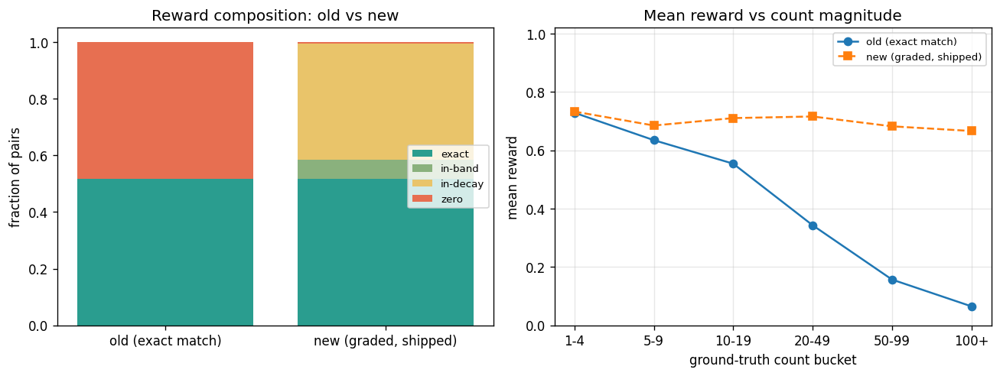
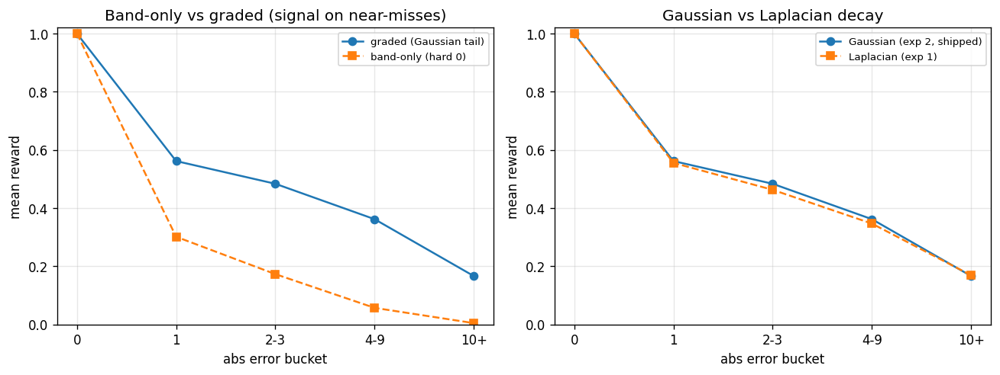
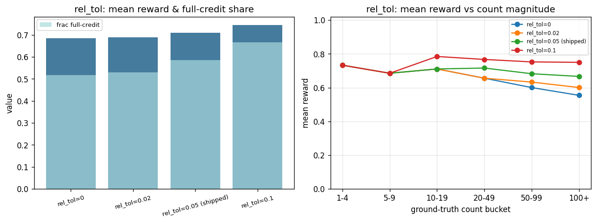
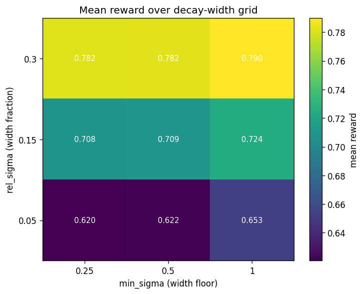
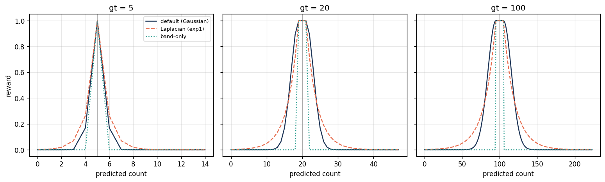

# Counting-reward ablation — offline study

**Decision context.** PR #40 (`9ac5e40`, on `main`) replaced the exact-match counting
reward with a **scale-aware graded (decaying-band)** reward. Chris asked for an
**offline-first** ablation: no training runs until an offline study says which reward
shapes are worth GPU time. This memo is that study — old vs new, band width, decay
width/shape, band-only vs graded — plus a ranked shortlist of training arms.

- **Formula + knobs:** [`counting_reward_formula.md`](../../counting_reward_formula.md).
- **Harness (regenerates every figure/table below with one command):**
  `vero2_scripts/debug_scripts/counting_reward_ablation.py`.
- **Raw metrics:** [`assets/counting-reward-ablation/summary.json`](assets/counting-reward-ablation/summary.json),
  `variant_summary.{csv,md}`, `by_gt_bucket.csv`.

```bash
# one command; writes plots + tables + summary.json into docs/vero2/assets/counting-reward-ablation/
python vero2_scripts/debug_scripts/counting_reward_ablation.py
```

## Data

The harness replays **10,585 real `(pred, gt)` counting pairs** from the Gemini
ground-truth filter's `decisions.jsonl`: `pred = blind.count` (a strong VLM's count,
produced *without ever seeing* the ground truth) vs `gt = ground_truth`. Blind counts
are the best realistic offline proxy for policy predictions we have.

| gt bucket | 1–4 | 5–9 | 10–19 | 20–49 | 50–99 | 100+ |
|---|---|---|---|---|---|---|
| # pairs | 2835 | 1873 | 2373 | 2133 | 803 | 568 |

Overall the blind counter is **exact on 51.6%** of pairs; the error distribution is
`{0: 5465, 1: 1506, 2–3: 1162, 4–9: 1123, ≥10: 1329}`. Two caveats: (1) a training
policy — especially early — is weaker and more spread-out than this strong blind
counter, so the *fraction* of pairs sitting in the graded region (and thus the
gradient benefit) is likely **larger** in real training than measured here; (2) offline
analysis characterizes reward **shape**, not learning dynamics — it cannot by itself
rank which reward *trains* best. It tells us which shapes differ enough to matter and
which controls make a training study interpretable.

### How to read these numbers under GDPO/GSPO

The training YAML uses `adv_estimator=gdpo`, `loss_mode=gspo`, `n=8` — a
**group-relative** advantage. The absolute reward **level cancels** inside a group;
only the **spread** of rewards across a prompt's rollouts trains. Two consequences
frame every table below:

- A **high mean reward is not disqualifying** on its own (it cancels). The enemies are
  **flat regions**: mass piled at exactly **0** (a miss-by-3 and a miss-by-50 both
  score 0 → no gradient to prefer the closer rollout) or at a **full-credit plateau**
  (several near answers all score 1.0 → indistinguishable). So `frac_zero`, the
  full-credit `in-band` share, and the **`mean_reward_by_err` spread** matter more than
  the mean.
- Counting is weighted **1:1:1 with chart and search** (`data.per_batch_domain_weights`)
  and its accuracy carries **0.8** of the score blend (`gdpo_reward_weights: [0.8, 0.1,
  0.1]`, the rest format + tool-efficiency). Counting is thus ~1/3 of a batch and its
  reward delta is diluted in any aggregate metric — **judge every arm on
  counting-domain exact-accuracy, not blended reward.**

## Headline: old exact-match vs new graded



The exact-match reward is **scale-blind and sparse**: because getting a large count
exactly right is nearly impossible, its mean reward **collapses from 0.73 at gt=1–4 to
0.065 at gt≥100**, and **48.4% of all pairs score exactly zero** — no gradient on
almost half the data, and essentially none on large counts. The graded reward stays
**flat (~0.67) across every magnitude bucket** and converts that dead-zero mass into a
smooth learning signal:

| reward | mean R | exact | in-band (near-miss → 1.0) | in-decay (0<R<1) | zero |
|---|---|---|---|---|---|
| **old exact-match** | 0.516 | 0.516 | 0.000 | 0.000 | **0.484** |
| **new graded (shipped)** | 0.709 | 0.516 | 0.068 | **0.409** | **0.007** |

The exact fraction (51.6%) is a property of the data and is identical across variants —
the reward change acts entirely on the other 48.4%: **41% of all pairs move onto a
smooth gradient**, 7% get a scale-aware full-credit band, and the flat-zero share drops
from 48% to **<1%**.

## Leniency vs gradient: band-only isolates the two effects

The graded reward does two things at once — it (a) grants a **scale-aware full-credit
band** (leniency) and (b) adds a **smooth decay** outside it (gradient). Setting
`counting_graded=false` keeps the band but drops the decay, separating them:

| reward | mean R | zero | near-miss mean R | what it adds |
|---|---|---|---|---|
| old exact-match | 0.516 | 0.484 | 0.000 | — |
| band-only (`graded=false`) | 0.585 | 0.415 | 0.142 | + scale-aware **leniency** band |
| graded (shipped) | 0.709 | 0.007 | 0.398 | + **decay gradient** |

**~1/3 of the graded gain is the band (0.516→0.585), ~2/3 is the decay gradient
(0.585→0.709).** The decay is the larger effect and the only one that removes the
zero-gradient cliff (zero-fraction 0.415 → 0.007). This is the central argument for the
graded reward, and it makes band-only vs graded the sharpest single training contrast.



## Band width — `rel_tol`



`rel_tol` sets the full-credit band `floor(rel_tol·|gt|)`. It trades exactness for
leniency and barely touches the zero-fraction (the decay already covers near-misses):

| `rel_tol` | mean R | in-band | in-decay | near-miss mean R |
|---|---|---|---|---|
| 0.00 | 0.684 | 0.000 | 0.477 | 0.347 |
| 0.02 | 0.689 | 0.014 | 0.463 | 0.357 |
| **0.05 (shipped)** | 0.709 | 0.068 | 0.409 | 0.398 |
| 0.10 | 0.745 | 0.150 | 0.327 | 0.473 |

`rel_tol=0` keeps the full gradient but gives **no** full-credit band — every non-exact
answer decays, even a `100` vs `101`. `rel_tol=0.10` hands full credit to 15% of pairs,
including `gt=100` answers off by up to 10 — the **reward-hacking risk**: the policy can
farm full credit by landing "roughly near" a large count. The shipped `0.05` is a
middle ground (full credit only from gt≥20, and only within ±5%).

## Decay width — `rel_sigma` × `min_sigma`



`rel_sigma` is the **dominant lever on overall reward level**; `min_sigma` (the width
floor) only matters for small counts where `rel_sigma·gt < min_sigma`.

| | min_sigma 0.25 | 0.5 | 1.0 |
|---|---|---|---|
| **rel_sigma 0.05** | 0.620 | 0.622 | 0.653 |
| **rel_sigma 0.15 (shipped)** | 0.708 | 0.709 | 0.724 |
| **rel_sigma 0.30** | 0.782 | 0.782 | 0.790 |

Narrow (`0.05`) is close to exact-match in spirit — sharp peak, **2.9%** back to zero,
near-miss mean R only 0.22. Wide (`0.30`) is very lenient — near-miss mean R 0.55,
almost nothing at zero — but risks **flattening the gradient** (reward approaches a
near-uniform high value, which carries little signal). The shipped `0.15 / 0.5` sits in
the middle. `min_sigma` is a minor knob: at `rel_sigma=0.15` moving it 0.25→1.0 shifts
the mean only 0.708→0.724, and only via small counts.

## Decay shape — Gaussian vs Laplacian



Gaussian (`decay_exp=2`, shipped) vs Laplacian (`decay_exp=1`) are **nearly identical in
aggregate** (mean 0.709 vs 0.704). The difference is in the tail: Laplacian's fatter
`exp(−x)` tail gives more credit to large errors and drives the zero-fraction to
**0.0%** (vs 0.7%). Whether that fat tail helps (denser signal on gross misses) or hurts
(rewards very wrong answers) is exactly the kind of question offline can't settle — but
the effect size is small, making this the lowest-priority lever.

---

## Shortlist — variants worth GPU time

A four-agent panel (training-signal / reward-hacking / scientific-control /
compute-pragmatist lenses) plus two adversarial verifiers (which reconciled every
number below against `summary.json` to rounding) converged on the following ladder.
Every arm runs the **identical** config and code and differs **only** in
`reward_kwargs.counting_*`, so each is a true one-variable ablation on a shared
exact-match backbone (all arms hold `frac_exact = 0.516`). **Budget rule:** 2 runs →
arms 1–2; 3 runs → +arm 3; 4 runs → +arm 4.

| # | arm | role | Hydra overrides (on top of the shipped config) | offline signature |
|---|---|---|---|---|
| 1 | **graded_default** | reference (the hub) | *(none — empty `counting_*` is bit-identical to shipped)* | mean 0.709; zero 0.007; by_err spread 1.0/0.56/0.48/0.36/0.17; by_gt flat 0.73→0.67 |
| 2 | **exact_match** | baseline (the counterfactual) | `+…counting_rel_tol=0.0` `+…counting_rel_band_cap=0.0` `+…counting_graded=false` | mean 0.516; **zero 0.484**; by_err 1.0/0/0/0/0; by_gt **collapses 0.73→0.065** |
| 3 | **sigma030** | treatment (decisive) | `+…counting_rel_sigma=0.30` | mean 0.782; zero 0.003; by_err 1.0/0.72/0.63/0.53/0.30; near-miss mean 0.55 |
| 4 | **band_only** | control (band vs decay) | `+…counting_graded=false` | mean 0.585; **zero 0.415**; by_err 1.0/0.30/0.17/0.06/0.01; by_gt re-collapses to 0.305 |

(`…` = `reward.custom_reward_function.reward_kwargs`. The leading **`+`** is required —
these keys are absent from the shipped `reward_kwargs`; a bare `=` raises a Hydra struct
error. Overrides validated to compose offline against the shipped config.)

`trainer.experiment_name` per arm: `counting_reward_graded_shipped`,
`counting_reward_exact_baseline`, `counting_reward_sigma030`, `counting_reward_band_only`.

**What each contrast buys.** `{graded vs exact}` (arms 1–2) is the headline — did
retiring exact-match pay off? `{band_only vs graded}` (arms 4–1) attributes the graded
gain specifically to the **decay gradient** vs the leniency band (the +0.069/+0.124
split). `{sigma030 vs graded}` (arms 3–1) asks whether the shipped decay is too tight,
leaving near-miss gradient on the table.

**Two panel cautions, carried forward.**
- **`sigma030` reward-hacking risk (the sole dissent).** A wider σ awards **~0.97** to
  `gt=100, pred=110` (vs ~0.90 shipped) and slightly *inverts* the difficulty ordering
  (`by_gt` 100+ 0.793 > 1–4 0.759) — it could teach "roughly right is fine" on large
  counts. Under group-relative GDPO that cross-bucket level inversion doesn't directly
  train (within-group spread does, and `by_err` stays monotone), but the failure is real
  and only a run can see it. **Mitigation:** gate on counting-domain **exact-accuracy**;
  if it games, swap in the hack-resistant **`rel_tol=0` graded** (`+…counting_rel_tol=0.0`,
  arm `reltol0` in the launcher) — it deletes the full-credit plateau so only exact
  answers score 1.0 and uniquely restores a downward difficulty slope, at the lowest
  graded mean (0.684) with the widest reward-vs-error spread of any arm (0.441).
- **Keep the comparison honest.** Hold `n=8`, `temperature=1.0`, step count, and data
  identical across arms; the only difference is `reward_kwargs.counting_*`.

### Rejected (offline says not worth a run)

- **`rel_tol=0.10`** — widens the full-credit dead-zone to **15%** and hands a perfect
  1.0 to wrong-but-close large counts (`gt=100` accepts 90–110); *enlarges* the
  no-gradient plateau. Reward-hacking risk, the opposite of denser signal.
- **Laplacian (`decay_exp=1.0`)** — aggregate near-identical to Gaussian (0.704 vs
  0.709); only real delta is 0.0% vs 0.7% zero — too small to move learning, and its
  fatter tail rewards gross misses. Keep `decay_exp=2`.
- **`rel_sigma=0.05`** — over-sharp: triples `frac_zero` (0.007→0.022), collapses the far
  tail (`err≥10` → 0.041) and re-starves large counts — partially *reintroduces* the
  exact-match pathology. Hold only as a "bracket-below" reserve.
- **`min_sigma` sweeps (0.25 / 1.0)** and **`rel_tol=0.02`** — micro-tuning; effect
  confined mostly to small counts (already near-exact) / a non-diagnostic interpolation.

## Launching an arm (prepared, not launched)

> **Do not launch multi-GPU training without checking with Chris** (per TASK.md).

Two things change per arm relative to a normal vero2 run:

1. **Reward knob** — a Hydra override (validated to compose against the shipped config):
   `+reward.custom_reward_function.reward_kwargs.counting_<knob>=<value>`.
2. **Data** — the standard train/val jsonls contain **zero counting rows** (the
   configured `chart_search_counting_..._train...jsonl` is 100% `search` despite its
   name), so a counting arm must train on the counting data. `data.train_files` accepts a
   list, so mix in (or swap to) the filtered counting jsonls:
   - train: `/scratch/gpfs/ZHUANGL/lc1556/vero2/dataset_filter_runs/full_sync/filtered/combined_counting_train.filtered.partial.verl.jsonl`
   - val: `…/combined_counting_val.filtered.partial.verl.jsonl`

A prepared launcher — `vero2_scripts/run_counting_reward_ablation.sh` — wires both plus a
distinct `trainer.experiment_name` per arm. Pick the arm with `ARM=` (`graded` | `exact`
| `wide_sigma` | `band_only` | `reltol0` | `laplacian`) and the data policy with
`DATA_MODE=` (`counting_only`, default — cleanest for a reward ablation — or `mix` to
append counting to the existing blend):

```bash
# smoke each arm on gpu-test first (<1h; uncomment the gpu-test header in the script)
ARM=graded     sbatch vero2_scripts/run_counting_reward_ablation.sh   # arm 1 (reference)
ARM=exact      sbatch vero2_scripts/run_counting_reward_ablation.sh   # arm 2 (baseline)
ARM=wide_sigma sbatch vero2_scripts/run_counting_reward_ablation.sh   # arm 3 (treatment)
ARM=band_only  sbatch vero2_scripts/run_counting_reward_ablation.sh   # arm 4 (control)
```

The launcher's Hydra args (the `counting_*` overrides and the list-form
`data.train_files=[…]`) were verified to compose offline against the shipped config.
**Confirm with Chris before any multi-GPU launch**, including which data policy
(`counting_only` vs `mix`) and base config to use.
